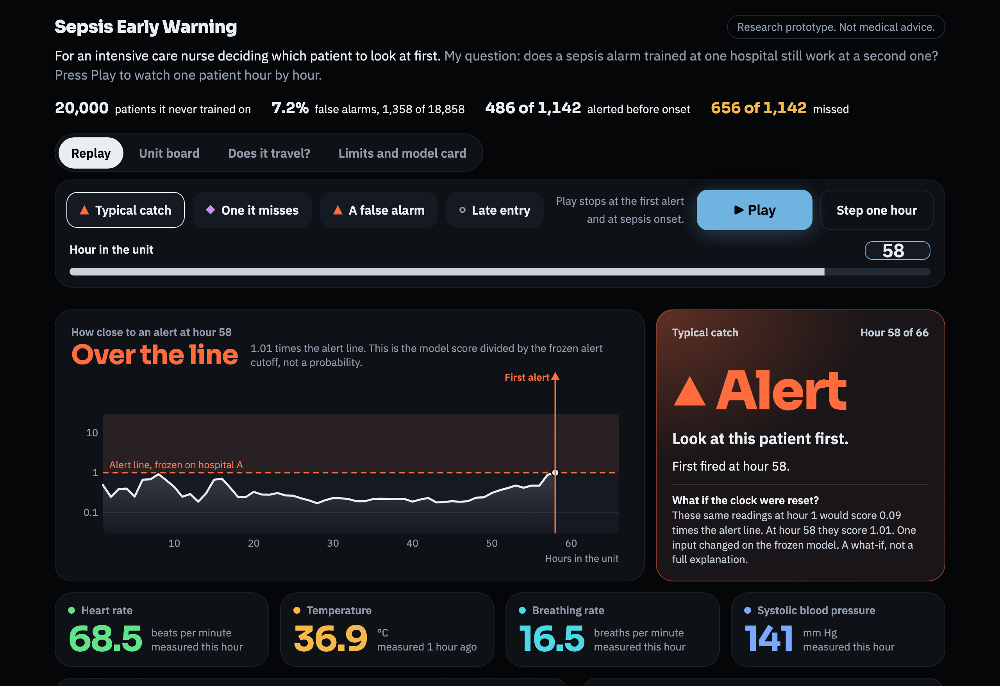
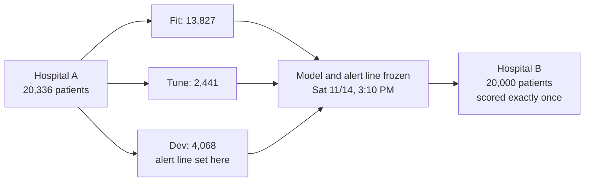
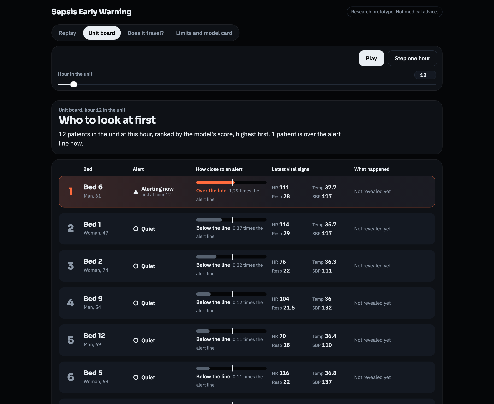

# Sepsis Early Warning: does it travel?

> **This project is a prototype and is not medical advice.**

I trained a sepsis early warning model on intensive care records from one hospital, froze it, and scored it exactly once at a second hospital. This repository holds the model, the test, a decisions log with a time on every choice, and a tool that replays real, de-identified patient stays hour by hour.

**Veritas AI International High School Hackathon, Health track.** Built solo by Tanner Barber in the 48 hour window that opened on Sat 11/14/2026.

**[One page write-up (PDF)](WRITEUP.pdf)** | **[Notebook with saved outputs](sepsis_early_warning.ipynb)** | **[Decisions log](DECISIONS.md)** | **[Definitions](DEFINITIONS.md)**



## The short version

**The user** is an intensive care nurse deciding which patient to look at first.

**The question:** does a sepsis alarm built at hospital A still work at hospital B?

**The answer: only partly.** At hospital B, of 1,142 patients who developed sepsis:

| What happened | Patients | Share |
|---|---|---|
| Timely catch: first alert in the 12 hours before onset | **109** | 9.5% |
| Alerted very early: more than 12 hours before onset | 377 | 33.0% |
| Missed | **656** | 57.4% |

Of the 18,858 patients who never developed sepsis, **1,358 (7.2%) got a false alarm.** The official challenge utility score fell from 0.368 at hospital A to 0.238 at hospital B, and a model that knows only how many hours the patient has been in the unit scored about the same (0.242).

### What it is good at

- **It is quiet.** At a hospital it had never seen, it raised 1,358 false alarms where the bedside SIRS rule raised 12,630. That is 9 times fewer. The rule scored below never alerting (-0.014). My model scored 0.238.
- **It still finds patients after the move.** It flagged 486 of 1,142 sepsis patients by onset at hospital B, with an hourly AUROC of 0.78.
- **It holds up next to a commercial alarm.** When the widely used Epic Sepsis Model was checked at an outside hospital, it had an AUC of 0.63, missed 67% of sepsis patients, and alerted on 18% of all hospitalized patients ([Wong et al., 2021](https://pmc.ncbi.nlm.nih.gov/articles/PMC8218233/)). Mine missed 57% with false alarms on 7.2%. Those are different patients, different sepsis definitions, and a different kind of AUC, so this is context and not a head to head test.
- **With local data it reaches the top teams' range.** After the frozen run, one model trained on both hospitals scored 0.402 at hospital A and 0.406 at hospital B. The challenge's official top five teams scored 0.395 to 0.434 at these two hospitals ([official results](https://moody-challenge.physionet.org/2019/results/challenge.tsv)). Their scores are on hidden test patients and mine are on the public patients, and my run is after-the-fact, so this is also context.

The weak spots are just as real, and they are in the results below.

## How the test was run



1. **Prediction first.** Before any model was trained I wrote down what I expected to happen at hospital B. It is in [DECISIONS.md](DECISIONS.md), with its time.
2. **One alert line.** I set it on hospital A dev so that at most 15% of patients who never develop sepsis get an alert.
3. **Freeze, then score once.** The model files and the alert line were committed before hospital B was opened. Hospital B was scored one time.
4. **Honest labels.** Everything I ran after that one score is marked "after-the-fact" everywhere it appears.

Hospital B is a site-held-out evaluation set, not a blinded test. Its patient counts, age and sex mix, and sepsis rates were summarized before modeling. No model, input, or alert line ever used it. The full disclosure is in [DEFINITIONS.md](DEFINITIONS.md).

## Results (version 1, the result of record)

Each method is one step up from the last, so each row shows what the next one adds.

| Method | Utility, A dev | Utility, B (95% range) | Timely at B | Missed at B | False alarms at B |
|---|---|---|---|---|---|
| Modified SIRS bedside rule | 0.090 | -0.014 (-0.051 to 0.023) | 306 of 1,142 | 176 | 12,630 of 18,858 (67.0%) |
| Hours in the unit only | 0.312 | 0.242 (0.217 to 0.268) | 79 of 1,142 | 717 | 2,581 of 18,858 (13.7%) |
| **Full model** (gradient boosting, 100 inputs) | **0.368** | **0.238** (0.214 to 0.262) | **109 of 1,142** | **656** | **1,358 of 18,858 (7.2%)** |

Utility is the challenge's official score. 1 is perfect and never alerting scores 0.

The full model at both hospitals, side by side:

| | Hospital A dev (4,068 patients, the calibration set) | Hospital B (20,000 patients) |
|---|---|---|
| Timely catches | 60 of 358 (17%) | 109 of 1,142 (9.5%) |
| Alerted very early | 162 of 358 | 377 of 1,142 |
| Missed | 136 of 358 | 656 of 1,142 (57%) |
| False alarms | 556 of 3,710 (15.0%) | 1,358 of 18,858 (7.2%) |
| False alarms per timely catch | 9.3 | 12.5 |
| Alerts per 1,000 patient-days | 232 | 115 |

The alert line was set on hospital A dev, so its 15.0% false alarm share is true by construction.

### What I learned

- **Timely catches were rare.** 109 of 1,142 at hospital B. I count an alert more than 12 hours before onset separately and never call it a catch.
- **The model got quieter, not noisier.** Hospital B records 0.94 lab values per patient-hour against 1.64 at hospital A, and its blood pressures read higher, so the model scored everyone lower there. I had predicted the opposite.
- **Time in the unit explains a lot.** At hospital B the full model did not beat a model that only knows the hour.
- **The bedside rule catches more and costs far more.** Modified SIRS alerted by onset on 966 of 1,142 sepsis patients at hospital B, and raised a false alarm on 67% of everyone else.
- **A second way to count, added after the frozen run.** 452 of 1,142 had the alert on at some hour in the 12 hours before onset, because 343 of the 377 "very early" patients were still alerting. The time-only model has 425 by the same count, so this does not change the finding. Numbers: `results/after_the_fact_alert_on_in_window.csv`.

### Where it fails

- **First-day sepsis.** When the sepsis label starts before hour 24, 57 of 514 patients were alerted by onset (11%), against 429 of 628 later in the stay (68%).
- **Late-entry patients, whose sepsis label is already on in their first recorded hour.** 14 of 223 caught. The SIRS rule caught 150 of the same 223.
- **Patients aged 80 and over.** 46 of 129 alerted by onset (36%), the worst age group. Under 50: 42%. 50 to 64: 40%. 65 to 79: 47%.
- **Women and men were close.** Alerted by onset: women 210 of 495 (42%), men 276 of 647 (43%). False alarms: women 6.2%, men 8.1%.

The data has no race or ethnicity field, so those groups were not checked. Five failure cases, picked by a rule and not by hand, are walked through in the notebook.

## After the frozen run: version 2 (after-the-fact)

**Version 1 above stays the result of record.** Everything in this section ran after hospital B had been scored, so none of it is a test of whether a model travels. Most of it uses a 25% false alarm cap where version 1 used a 15% budget, so it is a different test and not a like for like improvement on 0.238. Each plan was written into [DECISIONS.md](DECISIONS.md) before it ran. Every number is in `results/after_the_fact_v2_*.csv`.

| Experiment | Scored on | Utility | Sepsis patients missed | False alarms |
|---|---|---|---|---|
| One model trained on both hospitals, 25% cap at each | Hospital A, 16,268 patients | 0.402 | 399 of 1,432 | 25.4% |
| The same both-hospitals model | Hospital B, 20,000 patients | 0.406 | 220 of 1,142 | 25.2% |
| Both-hospitals model, cutoff that maximizes utility, no cap | Hospital A, 16,268 patients | 0.422 | 170 of 1,432 | 45.4% |
| The same model and rule | Hospital B, 20,000 patients | 0.407 | 219 of 1,142 | 26.0% |
| Frozen version 1 model, hospital A's 25% alert line unchanged | Hospital B, 18,000 patients | 0.265 | 484 of 1,024 | 15.2% |
| Frozen version 1 model, hospital B's own alert line, no labels | The same 18,000 | 0.271 | 383 of 1,024 | 28.0% |
| Backwards: trained at hospital B, 15% budget set there | Hospital A, 20,336 patients | 0.330 | 422 of 1,790 | 45.0% |

- **With hospital B's labeled patients in training, the model reaches about 0.40 at each hospital.** It was scored with nested cross-validation, which means no patient is scored by a model or an alert line that saw them. It has seen both hospitals, so it cannot claim to travel. It answers a different question: what do you get when a hospital has its own labeled data?
- **An alert line does not travel, in either direction.** A 15% budget set at hospital A delivered 7.2% at hospital B. A 15% budget set at hospital B delivered 45.0% at hospital A.
- **Local data helps fast, then slows.** On 10,000 hospital B test patients, utility was 0.262 with no local patients in training, 0.326 with 1,000, and 0.385 with 10,000. The cutoff for this curve was set on the same patients it scored, so it shows the shape only and is not a score to quote.
- **0.40 to 0.42 looks like the ceiling for these inputs.** Two libraries (scikit-learn and LightGBM), two tree counts, and three ways of setting the cutoff all land there. The 0.422 at hospital A is real, and its price is a false alarm on 45.4% of patients who never develop sepsis.
- **Ideas that failed and were dropped:** signature inputs (0.3994 against 0.3993), a hospital B only model (0.394 against 0.406), a score-shaped training target (0.374 against 0.399), and cutoffs by time in the unit (0.396 and 0.402 against 0.402 and 0.406).
- **How sure these numbers are.** Resampling patients 1,000 times puts the both-hospitals model at 0.402 at hospital A (95% range 0.381 to 0.422) and 0.406 at hospital B (0.383 to 0.429). Against each hospital's own model the difference is too small to call.

## The tool

`app/app.py` runs in the browser and has four tabs:

| Tab | What it shows |
|---|---|
| **Replay** | One real, de-identified stay, hour by hour: the vital signs, the model's score against the alert line, and when it alerted. The outcome stays hidden until the replay reaches it. |
| **Unit board** | 12 saved hospital B patients ranked by the model's score at each hour, the way a nurse would scan a unit. |
| **Does it travel?** | The hospital A against hospital B numbers, and the local data curve. |
| **Limits and model card** | Who the model is for, what it is not for, and the limits of this test. |



## Run it

```
python3 -m venv .venv
.venv/bin/pip install -r requirements.txt
.venv/bin/python -m pytest -q tests          # the checks
.venv/bin/jupyter notebook sepsis_early_warning.ipynb
.venv/bin/python app/app.py                  # the tool, at http://localhost:7860
```

The data is not stored in this repository. The notebook downloads it from the public source.

## What is in this repository

| Path | What it is |
|---|---|
| [sepsis_early_warning.ipynb](sepsis_early_warning.ipynb) | The whole project top to bottom, with outputs saved. It retrains the models and reproduces the frozen numbers. |
| [WRITEUP.md](WRITEUP.md) | The one page write-up ([PDF](WRITEUP.pdf)). |
| [DECISIONS.md](DECISIONS.md) | Every choice with its time and reason, the prediction committed before any model was trained, and how it compared with the result. |
| [DEFINITIONS.md](DEFINITIONS.md) | What "caught," "very early," "missed," "false alarm," and "onset" mean here. |
| [SPEC.md](SPEC.md) | The one page plan written before any code. |
| `src/` | The working code: inputs, models, scoring. |
| `tests/` | The checks, including that no input can see the future. |
| `results/` | Every reported number. `frozen.json` and `b_results.json` are the frozen run. |
| `scripts/` | One script per experiment, named for what it does. |
| `app/` | The tool. |
| `third_party/` | The challenge organizers' scoring script, unchanged. |

## Limits

- Retrospective. No nurse has used it, and nobody has acted on one of its alerts.
- Two hospitals from one public dataset. A third hospital was not tested.
- The sepsis label is built partly from when staff ordered antibiotics and cultures, so the model partly learns hospital habits.
- Records stop a few hours after sepsis onset.

## Data and credits

- **Data:** PhysioNet / Computing in Cardiology Challenge 2019, training sets A and B. Public, de-identified, license CC BY 4.0. https://physionet.org/content/challenge-2019/1.0.0/
- **Challenge paper:** Reyna MA, Josef CS, Jeter R, et al. "Early Prediction of Sepsis from Clinical Data: the PhysioNet/Computing in Cardiology Challenge 2019." Critical Care Medicine, 2020. https://pmc.ncbi.nlm.nih.gov/articles/PMC6964870/
- **Scoring:** the challenge organizers' own scoring script, unchanged, BSD 2-Clause license, in `third_party/`. Copied from https://github.com/physionetchallenges/evaluation-2019
- **Pretrained models:** none.
- **Libraries:** [pandas](https://pandas.pydata.org), [NumPy](https://numpy.org), [scikit-learn](https://scikit-learn.org), [Matplotlib](https://matplotlib.org), [Plotly](https://plotly.com/python/), [Gradio](https://www.gradio.app), [Jupyter](https://jupyter.org). [LightGBM](https://lightgbm.readthedocs.io) was used for one after-the-fact comparison only and is not needed to run anything here.
- **Fonts in the tool:** Sora and IBM Plex Sans, both under the SIL Open Font License, loaded from Google Fonts.
- **Tutorials:** the hackathon organizers' starter notebook, sent to registered teams. It is the reason this project uses scikit-learn.
- **AI tools:** [Claude Code](https://claude.com/claude-code) wrote most of the code from my decisions and ran the literature checks. I asked [ChatGPT (Codex)](https://openai.com/codex/) for an outside review. I chose the question, the user, the alert budget and the definitions, adopted the prediction before any model was trained, and decided what to keep.
